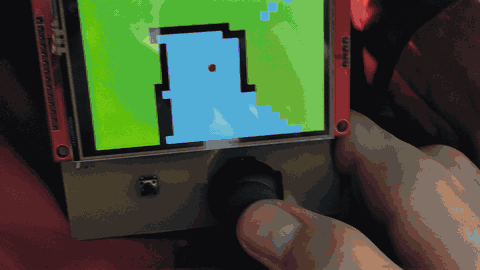
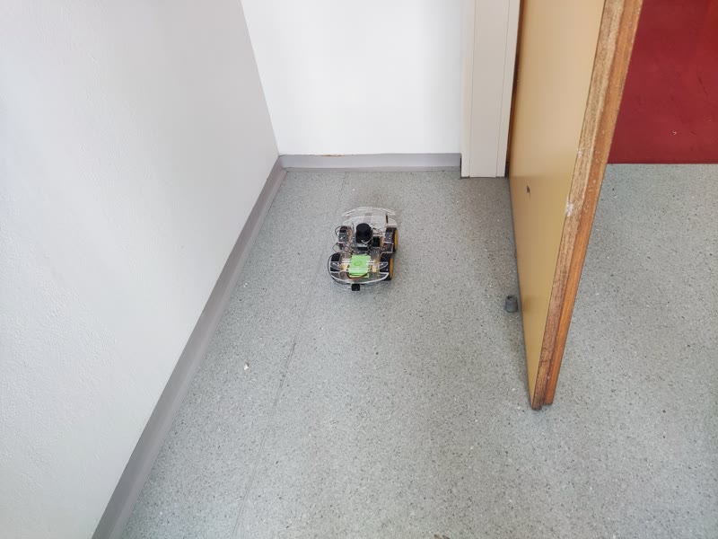
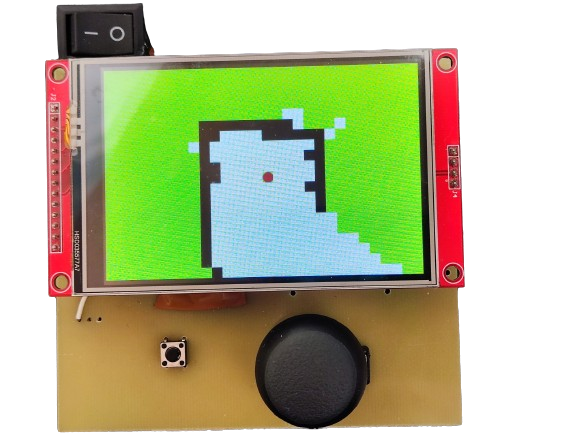
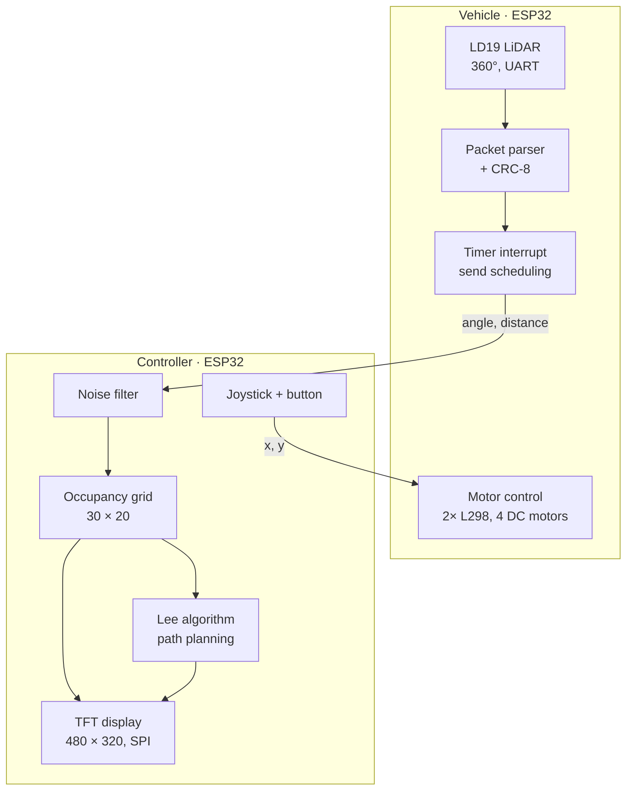
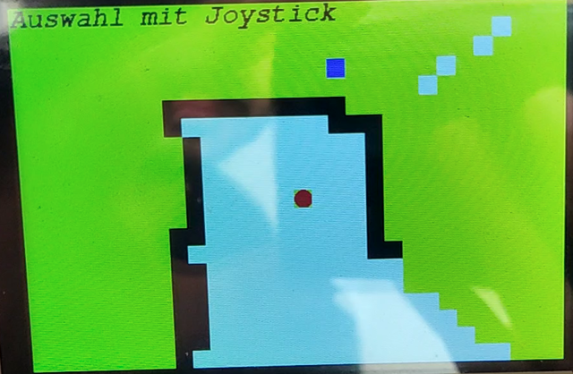
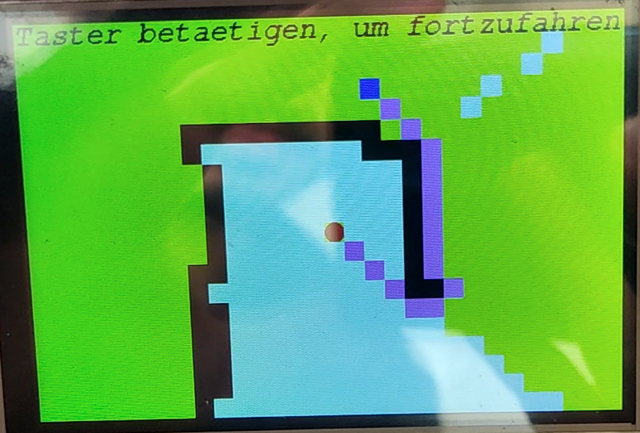
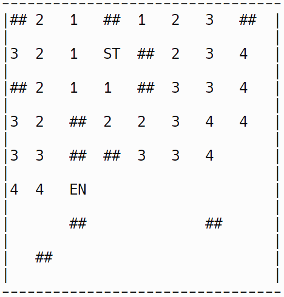
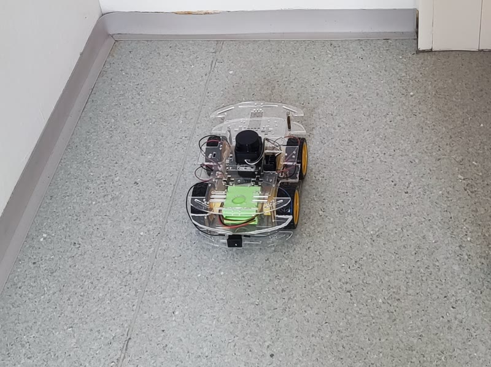
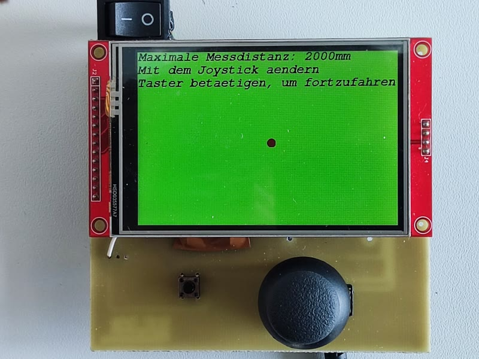
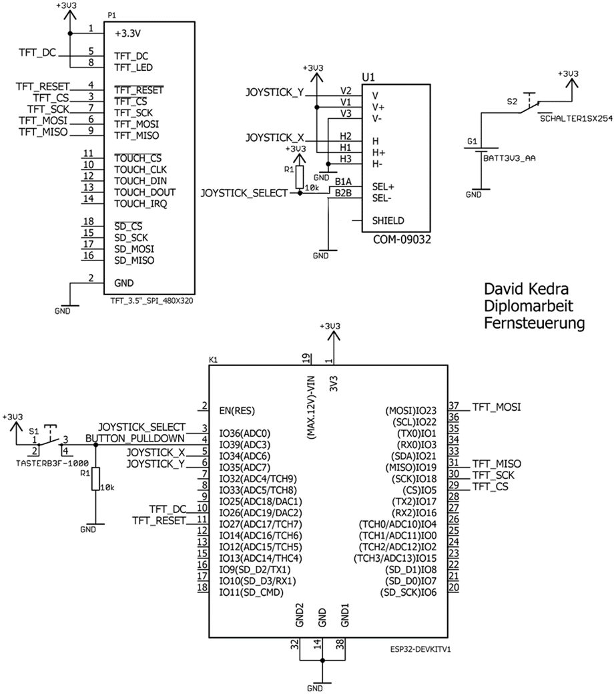

<div align="center">

# LiDAR Mapping RC Vehicle

**Remote-controlled vehicle with real-time 360° LiDAR mapping and on-controller path planning**

Diploma thesis (Diplomarbeit) · HTL Donaustadt, Vienna · 2023/24
**David Kedra** and **Berdan Kilic**




</div>

## Overview

A four-wheel vehicle carries a 360° laser distance sensor (LiDAR) and streams its measurements over Bluetooth to a handheld controller. The controller turns the raw data into a live top-down map of the vehicle's surroundings, shows it on a 3.5" display and drives the vehicle via joystick. The user can pick any point on the map, and the controller computes and draws the shortest route around the obstacles to get there.

Both devices run on ESP32 microcontrollers. The firmware, the communication protocol and the controller PCB were designed from scratch.

<table>
  <tr>
    <td align="center"><br><sub>The real environment</sub></td>
    <td align="center"><br><sub>The same corner as seen on the controller</sub></td>
  </tr>
</table>

## The problem

A remote-controlled vehicle is only really usable while the operator can see it. Once it drives around a corner or into another room, the operator has no idea what is around it. That rules out exactly the use cases where such a vehicle would be most helpful, such as inspection, surveillance or exploring spaces a person cannot easily enter. A camera stream is the usual answer, but it needs a lot of bandwidth and only shows one direction.

**Goal of the thesis:** give the operator a full 360° picture of the vehicle's surroundings in real time, over a simple low-bandwidth wireless link, and help them find a route to a chosen point.

## The solution

| Challenge | Approach |
|---|---|
| See all directions at once | LD19 360° LiDAR on the vehicle, read over UART at 230 400 baud, every packet verified with CRC-8 |
| Send scan data over a slow wireless link | Own lightweight message protocol over Bluetooth Classic (SPP). Only *angle + distance* pairs are sent, paced by a hardware timer interrupt |
| Sensor noise | Plausibility filter on the controller that discards physically impossible jumps between consecutive measurements |
| Turn measurements into a map | Polar to Cartesian conversion into a 30 × 20 occupancy grid (free / obstacle / unknown), with ray-tracing to mark the free space between sensor and obstacle |
| Show it fast on a small display | Incremental rendering: only grid cells that changed since the last frame are redrawn on the 480 × 320 SPI display |
| Find a way to a target | Target selected with the joystick, shortest path computed with the **Lee algorithm** (breadth-first wavefront search, 8-neighbourhood) and drawn on the map |
| Drive the vehicle | Joystick values travel back over the same link and are mapped to PWM for four DC motors via two L298 H-bridges |

## System architecture



Both arrows between the devices run over a single Bluetooth Classic connection (controller = master, vehicle = slave).

## Engineering decisions

**Choosing the platform.** The hardware went through three iterations before it worked reliably:

| Iteration | Setup | Why it was dropped |
|---|---|---|
| 1 | 2× Arduino Nano + HC-05 Bluetooth modules | Not enough memory and CPU for the map, display and LiDAR processing |
| 2 | Raspberry Pi 4 (controller) + ESP32 (vehicle) | No Linux driver library for the ILI9488 display. Writing one would have taken too long |
| 3 | 2× ESP32 with built-in Bluetooth | **Final.** Dropping the external modules also gave faster transfer, quicker pairing and lower latency |

**Optimising the mapping code.** The controller has to process LiDAR data, redraw the display and send joystick values at the same time, so the coordinate conversion was profiled on the ESP32. A benchmark of 720 rays took about 2200 ms. Caching sine and cosine per angle and pre-computing all constant scale factors brought it down to about 1500 ms, roughly **32 % faster**, see [`LidarMapper::calcPosition`](Programmcode/Fernsteuerung/LidarMapper.cpp).

**Low cost.** The main components (ESP32s, LiDAR, display, chassis with motors, motor drivers) cost about 130 €.

## Features

**Live 360° map** with the vehicle always in the centre. Five mapping modes, switched with the button:

| Mode | Behaviour |
|---|---|
| Save | Accumulates all measurements. Best while the vehicle stands still |
| Overwrite | New measurements replace old ones along the same ray. Best while driving |
| Full rotation | Redraws the map after each complete 360° sweep |
| Full rotation, slow | Same, with finer angular resolution |
| Automatic | Switches between *Save* and *Overwrite* depending on whether the joystick is idle |

**Route planning.** Press the joystick, move the cursor to a target, confirm. The shortest path around all known obstacles is calculated and shown:

<table>
  <tr>
    <td align="center"><br><sub>1. Select a target (blue)</sub></td>
    <td align="center"><br><sub>2. Shortest route around the wall (purple)</sub></td>
  </tr>
</table>

<details>
<summary><b>How the Lee algorithm works</b></summary>
<br>

Starting at the vehicle (`ST`), every reachable cell is labelled with its distance in steps, wave by wave, until the target (`EN`) is reached. Obstacles (`##`) are never entered. Walking back from the target along decreasing numbers gives the shortest path.



Implementation: [`LeeAlgorithm.cpp`](Programmcode/Fernsteuerung/LeeAlgorithm.cpp)
</details>

**More:**
- Adjustable range from 0.5 m to 12 m in 0.5 m steps (hold the joystick)
- Reset the map (hold the button)
- Automatic Bluetooth reconnect when the link drops

## Hardware

<table>
  <tr>
    <td align="center"><br><sub>Vehicle with LD19 LiDAR on top</sub></td>
    <td align="center"><br><sub>Controller on its own PCB</sub></td>
  </tr>
</table>

| | Vehicle | Controller |
|---|---|---|
| Microcontroller | ESP32 | ESP32 DevKit V1 |
| Input | LDROBOT LD19 360° LiDAR | Analog joystick (SparkFun COM-09032), push button |
| Output | 4 DC motors via 2× L298 H-bridge | 3.5" TFT, 480 × 320, ILI9488, SPI |
| Design files | [`Platinen/Fahrzeug`](Platinen/Fahrzeug) | [`Platinen/Fernsteuerung`](Platinen/Fernsteuerung) |

<details>
<summary><b>Controller schematic</b></summary>
<br>

</details>

## Bluetooth protocol

Each message is a short list of integers, sent as ASCII digits:

```
<type> \n <value 1> \n <value 2> \0
```

| Type | Direction | Values |
|---|---|---|
| `0` JOYSTICK | controller → vehicle | x, y (12-bit ADC) |
| `1` LIDAR | vehicle → controller | angle (°), distance (mm) |

The receiver checks length and characters and drops corrupted messages instead of acting on them.

## Repository structure

```
Programmcode/
├── Fahrzeug/           Vehicle firmware: LiDAR driver, motor control, Bluetooth slave
└── Fernsteuerung/      Controller firmware: mapping, display, Lee algorithm, joystick, Bluetooth master
Platinen/               EAGLE schematics (.sch) and board layouts (.brd)
docs/                   Presentation, project pitch, images
Lidar doku/             LD19 datasheet
Display doku/           Display manual, Adafruit GFX reference
Umgebungsspeicherung/   Early test code for the mapping logic
```

## Build and flash

1. Install the [Arduino IDE](https://www.arduino.cc/en/software) and the **esp32** board package by Espressif.
2. Install the controller libraries via the Library Manager: `Adafruit GFX Library`, `ILI9486_SPI`.
3. Upload `Programmcode/Fahrzeug/Fahrzeug.ino` to the vehicle ESP32.
4. Upload `Programmcode/Fernsteuerung/Fernsteuerung.ino` to the controller ESP32.
5. Power both. The controller finds and connects to the vehicle automatically.

> On the vehicle the LiDAR is read on the same hardware UART as the USB serial port, so its TX line may need to be disconnected while uploading.

## Team

| | Responsibilities |
|---|---|
| **David Kedra** ([@DeeQay](https://github.com/DeeQay)), project lead | Bluetooth communication and protocol, map visualisation, environment mapping, route planning. Controller hardware and PCB |
| **Berdan Kilic** ([@kilic7](https://github.com/kilic7)) | Vehicle control and motor drivers, 360° LiDAR data acquisition. Vehicle hardware and PCB |

Supervisors: Ahmet Kilic, Heinrich Haager

## Documents

<!-- - [Diploma thesis (PDF, German)](docs/Diplomarbeit.pdf) -->
- [Final presentation (PDF, German)](docs/Diplomarbeit_Praesentation.pdf)
- [Project pitch, October 2023 (PDF, German)](docs/Projektvorstellung_2023-10.pdf)
- [Project description (German)](Diplomarbeit%20Projektbeschreibung.docx)

## Limitations and next steps

- **No odometry.** The map is always relative to the vehicle's current position and is refreshed while driving, not stitched into one global map. Wheel encoders or an IMU would allow real SLAM.
- **Route is advisory.** The path is shown to the operator, the vehicle does not follow it on its own yet.
- **Bandwidth.** Bluetooth Classic limits how many points per second reach the controller, which is why the grid is kept coarse (30 × 20). BLE or Wi-Fi (ESP-NOW) would allow a finer map.

---

<sub>Code comments and project documents are in German.</sub>
